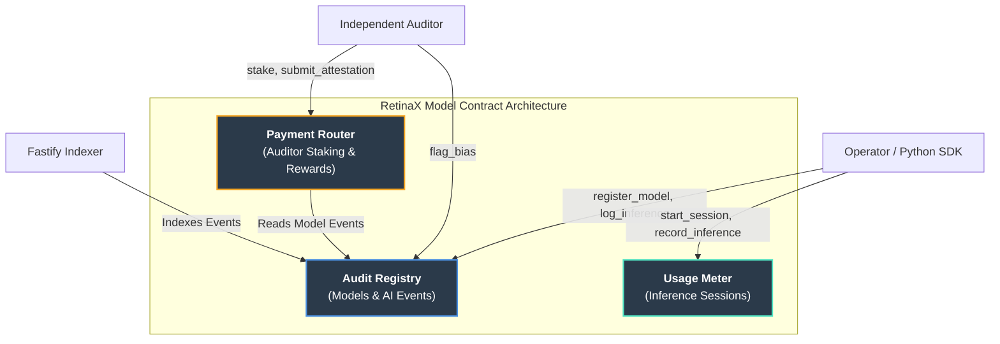

# RetinaX Model - Immutable AI Audit Trails on Stellar

[](https://www.rust-lang.org/)
[](https://soroban.stellar.org/)
[](LICENSE)
[](https://artificialintelligenceact.eu)

RetinaX Model is an on-chain audit protocol for AI systems on the Stellar blockchain, built with Soroban and Rust. It records every model registration, weight change and inference as an immutable, verifiable event, so operators, auditors and regulators can prove what a model knew, when it knew it, and what data shaped its decision. Built for AI labs, enterprises running high-risk models, independent auditors and compliance teams.

The protocol turns AI opacity into something structurally checkable. It combines the cost profile of Stellar with practical ML workflows (a Python SDK, an event indexer and a web dashboard) so comprehensive audit logging is economically viable at scale.

---

## Table of Contents

- [Project Overview](#project-overview)
- [Setup Instructions](#setup-instructions)
  - [Prerequisites](#prerequisites)
  - [Quick Start](#quick-start)
  - [Running Tests](#running-tests)
- [Features](#features)
- [Contract Architecture](#contract-architecture)
- [Project Structure](#project-structure)
- [Usage Examples](#usage-examples)
- [Regulatory Alignment](#regulatory-alignment)
- [Deployment](#deployment)
- [Roadmap](#roadmap)
- [Why Stellar Soroban](#why-stellar-soroban)
- [Helpful Links](#helpful-links)
- [Contribution Guidelines](#contribution-guidelines)
- [License](#license)
- [Support](#support)

---

## Project Overview

No system today is required to produce a cryptographic proof of its decisions: a language model denies a loan, a vision model flags a candidate, a diagnostic tool rules out cancer. This is a governance vacuum, not a technical limitation. RetinaX Model fills it with an on-chain event recorder purpose-built for the model, inference and training-data layers.

### Key Benefits

| Benefit | Description |
|---------|-------------|
| **Immutable Audit Trail** | Every model version and inference event is sealed on-chain |
| **Regulator-Ready** | Maps directly to EU AI Act, NIST AI RMF and ISO/IEC 42001 |
| **Low Cost** | About $0.00001 per event on Stellar, so every inference can be logged |
| **Independent Verification** | Auditors stake, attest and challenge, with no operator self-reporting |
| **Privacy-Preserving** | Only hashes and metadata go on-chain, never model internals |

### Target Users

- AI labs and model operators
- Enterprises running high-risk AI systems
- Independent AI auditors
- Regulators and compliance teams
- ML engineers integrating audit logging into pipelines

---

## Setup Instructions

### Prerequisites

- **Rust 1.78.0+** - [Install Rust](https://www.rust-lang.org/tools/install)
- **Stellar CLI** - [Install Stellar CLI](https://developers.stellar.org/docs/tools/cli/install-cli)
- **Node.js 18+** - For the web app and backend
- **Python 3.9+** - For the Python SDK (optional)
- **Git** - For version control

### Quick Start

```bash
# Clone the repository
git clone https://github.com/RetinaX-Org/retinaX-model.git
cd retinaX-model

# Build the audit registry contract
stellar contract build --package audit-registry

# Run all contract tests
cargo test --workspace

# Start the web app
cd apps/web && npm install && npm run dev
```

### Running Tests

```bash
# Run all contract tests
cargo test --workspace

# Run a single contract's tests
cargo test -p audit-registry
```

---

## Features

- Model registration with weights hash and training-data CID
- Per-inference event logging with risk levels
- Bias flagging by independent auditors
- Inference session metering (start, record, close, stats)
- Auditor staking, attestations, challenges and rewards
- Fastify event indexer backend
- Next.js dashboard with live audit stream and compliance views
- Python SDK for one-line inference logging

---

## Contract Architecture



---

## Project Structure

```
retinaX-model/
│
├── apps/
│   ├── web/                    # Next.js 14 dashboard
│   └── backend/                # Fastify event indexer
├── contracts/                  # Soroban smart contracts (Cargo workspace members)
│   ├── audit-registry/         # Model registration, AI event logging, bias flags
│   ├── usage-meter/            # Per-inference session metering
│   └── payment-router/         # Auditor staking, attestations, rewards
├── sdk/python/                 # Python SDK (retinax.py)
├── scripts/                    # Deployment scripts
├── docs/                       # Architecture, protocol specs, issue backlog
│
├── Cargo.toml                  # Workspace configuration
├── CONTRIBUTING.md             # Contribution guide
├── SECURITY.md                 # Security policy
└── README.md                   # This file
```

---

## Usage Examples

### Audit Registry

```rust
register_model(operator, name, version, weights_hash, training_data_cid) -> model_id
log_inference(operator, model_id, payload_hash, risk_level) -> event_id
flag_bias(auditor, model_id, evidence_hash) -> event_id
get_model(model_id) -> ModelRecord
get_stats() -> RegistryStats { total_models, total_events, high_risk_flags }
```

### Usage Meter

`start_session` → `record_inference` → `close_session` → `get_session_stats`

### Payment Router

`stake_as_auditor` → `submit_attestation` → `challenge_attestation` → `claim_reward`

### Python SDK

```python
from retinax import RetinaXClient
```

See [`sdk/python/retinax.py`](sdk/python/retinax.py) for the full client.

---

## Regulatory Alignment

| Framework | Requirement | Coverage |
|-----------|-------------|----------|
| **EU AI Act (2026)** | Art. 13: Transparency for high-risk AI | On-chain inference log |
| **EU AI Act** | Art. 12: Logging requirements | Immutable event registry |
| **NIST AI RMF** | Map & Measure: risk tracking | Risk level per inference |
| **ISO/IEC 42001** | AI management audit trail | Cryptographic provenance |

---

## Deployment

### Testnet Deployment

```bash
./scripts/deploy-testnet.sh
```

Fund your deployer identity with Stellar Friendbot before deploying.

### Live Deployments

| Component | URL |
|-----------|-----|
| Web app | https://retinax-model.vercel.app |
| API health | https://retinax-model-api.vercel.app/health |
| Audit Registry (testnet) | [`CDFM4HIU...WAUU`](https://stellar.expert/explorer/testnet/contract/CDFM4HIUGYRNNNO3TTH6PXAAGZSPSQ26ORHXZ7NHL5AVYZBX55C6WAUU) |
| Usage Meter (testnet) | [`CCAZYCPW...MFMZ6`](https://stellar.expert/explorer/testnet/contract/CCAZYCPW32ZEZQAXWHQQBGLE77RFHJ5YBAYJJNIANYN72H6YCUPMFMZ6) |
| Payment Router (testnet) | [`CAZB2WQG...EJFEG`](https://stellar.expert/explorer/testnet/contract/CAZB2WQGX5J3KD4D547VRXQPQMKB34E5K7US6SNUJOI6H2PCTU4EJFEG) |

---

## Roadmap

### Phase 0 - Foundation `DONE`
- [x] Audit Registry: model registration, inference logging, bias flagging, full tests
- [x] Web dashboard with live audit stream and compliance section

### Phase 1 - Core Protocol `Q2 2026`
- [ ] Usage Meter contract
- [ ] Payment Router: auditor staking and rewards
- [ ] All contracts deployed to Soroban testnet
- [ ] End-to-end audit lifecycle integration test
- [ ] Full event indexer backend

### Phase 2 - Enterprise Integration `Q3 2026`
- [ ] Python SDK: one-line inference logging for ML frameworks
- [ ] MLflow and Hugging Face Hub integrations
- [ ] OpenTelemetry exporter
- [ ] Grafana dashboard for real-time risk visualization

### Phase 3 - Compliance `Q4 2026`
- [ ] EU AI Act compliance certificate generation
- [ ] NIST AI RMF automated scoring
- [ ] Mainnet security audit

### Phase 4 - Mainnet & Scale `Q1 2027`
- [ ] Stellar Mainnet deployment
- [ ] AI lab partnerships for live inference tracing

---

## Why Stellar Soroban

AI audit trails generate millions of events per day. On Ethereum, logging each inference can cost $0.50-$5.00 in gas. On Stellar it costs about $0.00001 per event, which makes comprehensive AI auditing economically viable at scale.

---

## Helpful Links

### Documentation

- [Architecture Overview](docs/architecture.md)
- [Issue Backlog](docs/milestones-issues.md)

### Repository Resources

- [Contributing Guide](CONTRIBUTING.md)
- [Security Policy](SECURITY.md)

### External Resources

- [Stellar Developer Docs](https://developers.stellar.org/)
- [Soroban Documentation](https://soroban.stellar.org/docs)
- [Rust Documentation](https://doc.rust-lang.org/)

---

## Contribution Guidelines

We welcome contributions! Please follow these guidelines:

### Getting Started

1. **Fork** the repository
2. **Clone** your fork locally
3. **Create** a feature branch: `git checkout -b feature/your-feature`
4. **Make** your changes
5. **Test** your changes: `cargo test --workspace`
6. **Commit** with a descriptive message
7. **Push** to your fork
8. **Submit** a Pull Request

### Code Standards

- Follow Rust style guidelines (`cargo fmt`)
- Pass all Clippy lints (`cargo clippy`)
- Write tests for new functionality
- Update documentation as needed
- Use conventional commit messages

### Who We Need

- **Rust/Soroban engineers** - Usage Meter and Payment Router
- **ML engineers** - Python SDK, MLflow and Hugging Face integrations
- **TypeScript developers** - Wire the frontend to live contract state
- **Security researchers** - Audit the registry contract and staking mechanism

Issues are labeled `contract`, `sdk`, `frontend`, `backend`, `documentation` or `research`.

---

## License

This project is licensed under the MIT License.

---

## Support

- **Issues**: [GitHub Issues](https://github.com/RetinaX-Org/retinaX-model/issues)
- **Discussions**: [GitHub Discussions](https://github.com/RetinaX-Org/retinaX-model/discussions)

---

<p align="center">
  Built with ❤️ on Stellar
</p>
